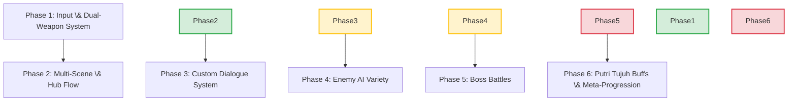

# The Origin of Gurindam: Project Roadmap (Updated)

This document outlines the prioritized roadmap for transitioning the current prototype into a fully realized Action Roguelite based on the Game Design Document and Research Paper, incorporating recent design decisions.

\---

## Roadmap Overview

The tasks are grouped into 6 development phases, prioritized from foundational mechanics to final Polish.

\---

## Prioritized Task Breakdown

### Phase 1: Input Expansion \& Dual-Weapon System (Priority: Critical) [COMPLETE]

*Goal: Complete player controls and distinguish between simultaneous melee and ranged combat.*

#### \[TASK 1.1] Input Configuration Update [COMPLETE]

* **Deliverable:** Update `InputSystem\_Actions.inputactions` to support:

  * **Melee Attack:** Left Click (Mouse) / X Button (Xbox) / Square (PlayStation).
  * **Ranged Attack (Alt-Attack):** Right Click (Mouse) / Y Button (Xbox) / Triangle (PlayStation).
  * **Skill Cast:** `E` Key / R2 Trigger.
  * **Ultimate Cast:** `Q` Key / R1 Shoulder.
  * **Interact:** `F` Key / A Button (Xbox) / Cross (PlayStation).
* **Estimation:** 3 Hours
* **Verification:** Input logs print distinct messages to console for both Melee and Ranged inputs.

#### \[TASK 1.2] Dual-Weapon Simultaneous Combat System [COMPLETE]

* **Deliverable:** Modify [Player.cs](file:///d:/Unity/Projects/Gurindam/Assets/Scripts/Player.cs) to handle two simultaneous combat inputs directly (no stance toggle):

  * **Melee Attack Action:** Instantiates melee swing hurtboxes in a sequence (Arbiter's Brush combo).
  * **Ranged Attack Action (Alt-Attack):** Draws a straight line/arrow on the ground from the player to the cursor when held and instantiates text-projectile hurtboxes (Inscribed Gurindam) along the assigned path when released.
* **Estimation:** 5 Hours
* **Verification:** Player can instantly transition between swinging the brush and shooting text bullets without needing to press a swap key.

#### \[TASK 1.3] Melee Sweep vs. Ranged Projectile Prefabs [COMPLETE]

* **Deliverable:** Set up primitive prefabs representing the Brush sweeps (wide overlap arcs) and Book projectiles (capsules that move forward). Configure properties on [Hurtbox.cs](file:///d:/Unity/Projects/Gurindam/Assets/Scripts/Hurtbox.cs) (speed, range, damage) for each attack type.
* **Estimation:** 4 Hours
* **Verification:** Melee attacks strike in a wide arc in front of player; ranged attacks shoot projectiles that travel forward and disappear on contact or after their lifetime.

#### Extra Phase 1 Enhancements (Implemented)

The following upgrades and features were added to Phase 1 beyond the initial roadmap specifications to refine combat feel, game feel, and camera dynamics:
* **Twin-Stick Strafing & Ranged Movement Modifiers:**
  * Enabled the player to move/slide in any direction while aiming the ranged alt-attack (decoupling character rotation from movement direction).
  * Reduced player movement speed by 60% and deceleration by 70% during aiming to create a slower, floaty, sliding "kiting" feel.
* **Aim-Cancel on Dash:**
  * Executing a dash will immediately cancel the active ranged aiming state and clean up the visual line renderers.
* **Advanced Cursor-Directed Auto-Aiming:**
  * Overhauled the auto-targeting logic to project the selection cone in the direction of the mouse cursor (aim direction) rather than the player's facing direction.
  * Implemented a multi-criteria prioritization sort: **Aim Cone (Highest) > Distance (within a tolerance of 2.0 units) > lowest Enemy Health (lowest priority)** to prioritize finishing off weak targets.
* **Slider-Like Visual Aim Indicator:**
  * Utilizes dual `LineRenderer` components: a transparent full-length "ghost" line showing the projectile's trajectory, and a solid "real" line that fills up over the charge duration.
  * Applied a small vertical Y-offset (`+0.01f`) to the foreground line to completely eliminate z-fighting with the background line.
  * Changes both LineRenderers' colors (from charging color to ready color) once the attack is fully charged.
* **Cinemachine Camera Zoom-Out & Cubic Ease-Out Zoom-In:**
  * Coupled camera zoom-out directly to the charge progress over the exact `chargedAttackDuration` by modifying `CinemachineCamera`'s `Lens.OrthographicSize`.
  * Decoupled the zoom reset transition from the charge duration, utilizing a **cubic ease-out speed curve** (driven by `cameraZoomInSpeed`) for a fast, snappy, and pop-free snapback.

\---

### Phase 2: Hub Scene \& Death Loop Flow (Priority: High)

*Goal: Integrate the rogue-lite game loop, including returning to the Sanctuary upon death.*

#### \[TASK 2.1] Multi-Scene \& Transition Setup

* **Deliverable:** Create `Sanctuary` (Hub) and `Castle\_Ruins` scenes. Implement a persistent `GameManager` or `SceneTransitionManager` to load levels, handle player persistence between scene loading, and reload/respawn at the hub on death.
* **Estimation:** 5 Hours
* **Verification:** Transitioning from Arena to Sanctuary, and spawning correctly back at the Sanctuary after dying.

#### \[TASK 2.2] Interaction System

* **Deliverable:** Write an `IInteractable` interface. Add interaction triggers to Sanctuary zones and hook them to the Player's Interact action to start events.
* **Estimation:** 3 Hours
* **Verification:** Player sees an "Interact" prompt and triggers console messages when near NPCs in the Hub.

\---

### Phase 3: Custom Dialogue \& Narrative System (Priority: Medium-High)

*Goal: Set up the narrative delivery and the collection of Gurindam Dua Belas fragments using a lightweight, custom ScriptableObject dialogue framework.*

> \[!NOTE]
> \*\*Why a Custom System?\*\* For an academic final project, writing a custom ScriptableObject dialogue manager is ideal. It keeps the codebase self-contained, has zero package dependencies, and directly demonstrates software engineering design patterns in the GDLC paper (e.g. data serialization and state machines).

#### \[TASK 3.1] Dialogue UI \& Custom DialogManager

* **Deliverable:** Create a screen-space Dialogue Canvas. Write a `DialogueManager` that reads custom `DialogueNode` ScriptableObjects (storing character name, portrait, and dialogue lines).
* **Estimation:** 6 Hours
* **Verification:** Dialogue text displays correctly, blocks player movement during conversations, and closes properly.

#### \[TASK 3.2] Raja Ali Haji Advisor Interaction

* **Deliverable:** Implement Raja Ali Haji NPC in the Sanctuary scene. Interacting with him triggers dialogues explaining the current biomes and checking the player's stanza collection progress.
* **Estimation:** 4 Hours
* **Verification:** Raja Ali Haji displays different text based on the player's run status.

#### \[TASK 3.3] Gurindam Stanza Collection Mechanics

* **Deliverable:** Define ScriptableObjects representing the 12 Articles of the Gurindam. Create a collectible item prefab to place in stages that unlocks a stanza fragment upon pickup and saves it run-wide.
* **Estimation:** 5 Hours
* **Verification:** Picking up a parchment item adds it to the player's inventory UI, unlocking specific poem text.

\---

### Phase 4: Enemy AI Variety (Priority: Medium)

*Goal: Refactor AI and create specific cultural enemies from the GDD.*

#### \[TASK 4.1] AI State Machine Refactoring

* **Deliverable:** Refactor [Enemy.cs](file:///d:/Unity/Projects/Gurindam/Assets/Scripts/Enemy.cs) into a base class with a modular state machine supporting: `Idle`, `Chase`, `CombatAttack`, and `Knockback/HitStun`.
* **Estimation:** 6 Hours
* **Verification:** Standard enemies transition smoothly between chasing, attacking when in range, and reacting to hits.

#### \[TASK 4.2] Melee Foes (Toyol \& Bandit)

* **Deliverable:**

  * **Toyol:** Fast, low-health, small collider, quick dash-attacks.
  * **Bandit:** Mid-health, cutlass strikes with brief forward lunge telegraphs.
* **Estimation:** 5 Hours
* **Verification:** Toyols swarm quickly while Bandits attack with slower, heavier strikes.

#### \[TASK 4.3] Ranged Foes (Archer \& Musketeer)

* **Deliverable:**

  * **Archer:** Keeps distance, aims, displays a warning line, and fires an arrow.
  * **Musketeer:** Long-range projectile attack with high damage but long reload times.
* **Estimation:** 7 Hours
* **Verification:** Ranged enemies back away from the player and fire visual projectiles.

#### \[TASK 4.4] Support Spellcaster (Sang Kelembai)

* **Deliverable:** Implement a slow-moving Sang Kelembai enemy that targets the player with a cursed ground area. If the player stands in it, they receive a temporary speed penalty.
* **Estimation:** 6 Hours
* **Verification:** Sang Kelembai channels a visual area-of-effect circle; staying inside applies a speed debuff.

\---

### Phase 5: Boss Battles (Priority: Medium-Low)

*Goal: Implement stage gatekeepers with unique challenge patterns.*

#### \[TASK 5.1] Cindaku (1st Stage Boss)

* **Deliverable:** Implement Cindaku's boss fight sequence in a dedicated `Burning\_Bridge` arena. Attacks: 3-hit rapid claw combo, target-seeking pounce, and rage mode (speed boost at low HP).
* **Estimation:** 10 Hours
* **Verification:** Cindaku triggers boss-specific UI health bars, executes telegraph states, and transitions to rage mode below 50% HP.

#### \[TASK 5.2] Gajah Mina (2nd Stage Boss)

* **Deliverable:** Implement Gajah Mina boss AI. Attacks: frontal water trunk spray (continuous cone damage + pushback) and shockwave stomp (creates radial ground rings player must jump/dodge).
* **Estimation:** 12 Hours
* **Verification:** Gajah Mina sprays water affecting player velocity, stomps, and spawns wave projectiles.

\---

### Phase 6: Putri Tujuh Buffs \& Meta Progression (Priority: Low)

*Goal: Complete the gameplay loop with customized, character-specific upgrades.*

#### \[TASK 6.1] Putri Tujuh Buff ScriptableObjects

* **Deliverable:** Create a ScriptableObject framework representing static stats upgrades and special abilities. Add character-specific buffs:

  * **Putri 1 (Damage):** Increases base damage (+25%).
  * **Putri 2 (Movement Speed):** Increases walking/dash speed (+20%).
  * **Putri 3 (Lingering Area Damage):** Spawns a damaging ink pool behind the player during a dash.
  * **Putri 4 (Kamikaze Dash):** Heightens defense multiplier during dash and enables dash to deal collision damage to enemies.
  * **Putri 5-7 (Utility/Defense):** Customize additional static perks (e.g. cooldown reduction, projectile width, max health).
* **Estimation:** 8 Hours
* **Verification:** Equipping different ScriptableObject buffs applies the correct stat multipliers or active abilities.

#### \[TASK 6.2] Randomized Encounter Upgrades UI

* **Deliverable:** Create a shop/altar UI panel in the Sanctuary scene when interacting with the Putri Tujuh. Randomize which 3 Putri buffs are offered to the player each run/encounter, but the stats they provide are static. Save and apply chosen buffs for the duration of the run.
* **Estimation:** 8 Hours
* **Verification:** Interacting with the Putri Tujuh displays a selection of 3 randomized perks. Choosing one applies it to the player stats and triggers the appropriate game mechanics.

\---

## Phase Summary \& Timeline

|Phase|Description|Estimated Effort|
|-|-|-|
|**Phase 1**|Input \& Simultaneous Dual-Weapon System|12 Hours|
|**Phase 2**|Sanctuary Hub \& Loop Loader|8 Hours|
|**Phase 3**|Custom ScriptableObject Dialogue System|15 Hours|
|**Phase 4**|Specialized Enemy AI|24 Hours|
|**Phase 5**|Boss Fights (Cindaku / Gajah Mina)|22 Hours|
|**Phase 6**|Putri Tujuh Buffs \& Meta Progression|16 Hours|
|**Total**|**Full Core Systems Implementation**|**97 Hours**|

